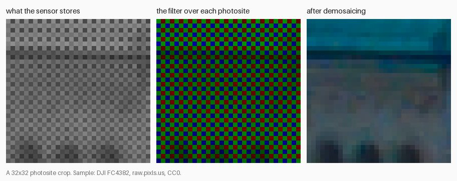
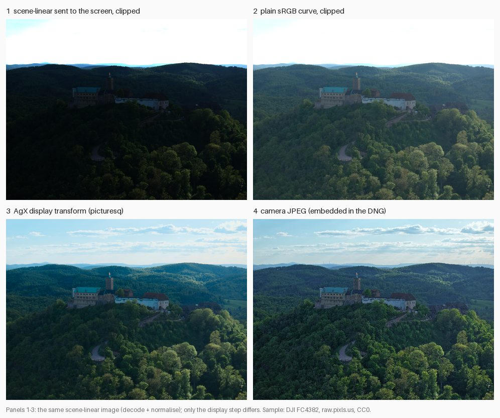
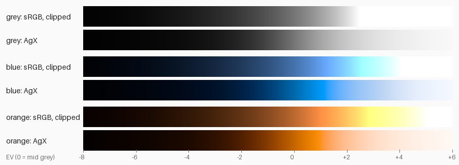

# M1 primer: from sensor numbers to a neutral render

M1 built the path from an **original** (a RAW file) to a JPEG that looks like the camera's own: **decode** → **normalise** (exposure only, for now) → **display transform** → **export**. This primer explains the four ideas that path rests on, each with one example from this project and a pointer to the code. It's meant as a 10-minute read; the [learning log](../learning-log.md) entries linked under each section go deeper.

The figures come from `scripts/primer_figures.py` (re-run it to regenerate them) and the CC0 sample `dji-fc4382.dng` (DJI FC4382, [raw.pixls.us](https://raw.pixls.us/getfile.php/7823/nice/DJI%20-%20FC4382%20-%2016bit%20(4:3).DNG), CC0).

---

## 1. A RAW file is numbers, not a picture

A camera sensor can only count light; it can't tell colours apart. To get colour, each photosite (sensor pixel) sits under a tiny red, green or blue filter, laid out in a repeating 2×2 pattern called a **Bayer mosaic**. The DJI Pocket 4 uses `R G / G B` (written `RGGB`): one red, two greens, one blue in every 2×2 block. Green gets two because our eyes are most sensitive to it.

So a RAW stores **one number per photosite**, and each pixel is missing two of its three colours. **Demosaicing** fills them in by looking at neighbours: "this photosite measured red; the green and blue here are probably like the greens and blues around it". Simple averaging smears colour across edges (you get coloured fringes and a "zipper" pattern); better algorithms such as AHD, our default, interpolate *along* an edge rather than across it.

*Left: what's stored. The checkerboard is the filters: under a teal roof, red photosites see little light, so every red site is dark. Middle: each number tinted by its filter. Right: after demosaicing, every pixel has all three colours. (This sample's pattern is `G R / B G`, the same idea shifted by one photosite.) Sample: DJI FC4382, raw.pixls.us, CC0.*

**Why a RAW looks dark and "flat".** The numbers are **scene-linear**: twice the light gives twice the number (section 2). Most of a scene is far below the sensor's maximum, and some cameras record the raw darker still, on purpose, to keep bright skies from clipping. In the DJI sample the median photosite is only **1 % of the sensor's white level**. The DNG says how much to brighten (its `BaselineExposure` tag, +1.32 stops here), and normalise adds the camera-fitted +2.0 stops on top.

**Where this lives:** `decode/raw.py` (`decode_original`: LibRaw does the demosaic and white balance, `decode.demosaic` picks the algorithm), `decode/exposure.py` (`BaselineExposure`), `pipeline/proxy.py` (proxies skip demosaicing by treating each 2×2 block as one pixel).
**Deeper:** [RAW files and decoding](../learning-log.md#2026-10-11--raw-files-and-decoding), [Inside a Pocket 4 DNG](../learning-log.md#2026-10-12--inside-a-pocket-4-dng), [BaselineExposure](../learning-log.md#2026-10-12--baselineexposure-the-camera-underexposes-on-purpose), [Demosaicing](../learning-log.md#2026-10-17--demosaicing-guessing-two-thirds-of-every-pixel).

---

## 2. Scene-linear vs display-referred

Two different kinds of number flow through the pipeline:

- **Scene-linear**: proportional to light in the scene. Mid grey (a surface reflecting 18 % of the light) is 0.18. There's no upper limit: a sunlit cloud can be 3.0, the sun itself 1000. Everything from decode up to the display transform is scene-linear.
- **Display-referred**: what a screen should show, 0 to 1 (0–255 in a JPEG), and **encoded** with the sRGB curve, which spends more of its 256 steps on dark tones because our eyes are more sensitive there. Mid grey 0.18 is stored as 0.46 (117/255).

Physical operations, like exposure (more light) and white balance (more light in one channel), are *multiplications of light*, so they're only correct on scene-linear values.

**The gotcha: doing it after the curve.** Take mid grey and add one stop of exposure (double the light). In linear: 0.18 × 2 = 0.36. Correct. Do the same to the encoded value instead: 0.46 × 2 = 0.92, which decodes to scene-linear 0.83, that's **4.6× the light (+2.2 stops) instead of 2×**, and the error is different for every brightness, so contrast changes too. White balance done the same way goes wrong per channel: a 1.5× red gain on encoded mid grey is a 2.4× gain in light, so the colour cast is over-corrected. That's why picturesq applies every exposure and white balance change before the display transform, and the sRGB curve is the very last step before 8-bit.

**Where this lives:** `colour/transfer.py` (`srgb_encode`/`srgb_decode`, `linear_to_ev`), `normalise/exposure.py` (exposure is `× 2**ev` in linear), `pipeline/export.py` (`render_output`: display transform, then sRGB encode, then 8-bit).
**Deeper:** [Linear vs display encoding](../learning-log.md#2026-10-11--linear-vs-display-encoding), [EV is log2 of light](../learning-log.md#2026-10-12--ev-is-log2-of-light), [The sRGB curve is not gamma 2.2](../learning-log.md#2026-10-12--the-srgb-curve-is-not-gamma-22), [Bit depth and quantisation](../learning-log.md#2026-10-12--bit-depth-and-quantisation).

---

## 3. Colour spaces and gamuts

An RGB triple means nothing until you say *which* red, green and blue. A **colour space** fixes three things: the **primaries** (the exact red, green and blue), the **white point** (the colour of R = G = B; ours is always D65 daylight) and the **transfer function** (linear, or the sRGB curve).

picturesq uses two:

| | Working space (inside picturesq) | Output (JPEG) |
|---|---|---|
| Primaries | Rec.2020: very saturated, covers almost every colour a camera records | Rec.709 = sRGB's primaries: what a normal screen can show |
| Transfer function | linear | sRGB curve |
| Range | any float (above 1 and below 0 are fine) | 0–255 |

The set of colours a space can mix is its **gamut**. Rec.2020's gamut contains sRGB's with room to spare, mostly in greens and cyans. A colour inside Rec.2020 but outside sRGB is **out-of-gamut** for the export, and converting it doesn't fail: it comes out with a **negative channel**. Example: a saturated foliage green, Rec.2020 `[0.2, 0.6, 0.2]`, is sRGB `[−0.035, 0.653, 0.160]`. "Negative red" means "greener than sRGB's green can go". Clip that to 0 and you lose the difference between this green and every other too-green green, so detail in leaves and flowers flattens. picturesq keeps negatives all the way through, and leaves it to the display transform to bring such colours into range gracefully.

Conversions between linear spaces are a single 3×3 matrix, and only valid on linear values (another reason the sRGB curve comes last). Decode also uses a matrix, the camera's **colour matrix**, to turn the sensor's own red, green and blue into the working space.

**Where this lives:** `colour/spaces.py` (primaries, white point, matrices derived from them), `decode/dng_colour.py` (the camera → working space matrix), `colour/agx.py` (converts to Rec.709 and handles negatives).
**Deeper:** [A colour space is primaries + white point + transfer function](../learning-log.md#2026-10-12--a-colour-space-is-primaries--white-point--transfer-function), [Gamut: why negative pixel values are normal](../learning-log.md#2026-10-12--gamut-why-negative-pixel-values-are-normal), [A camera has two colour matrices](../learning-log.md#2026-10-17--a-camera-has-two-colour-matrices-and-the-light-decides-the-mix).

---

## 4. Display transforms: you can't just clip

A sunny scene spans 15 or more stops of light; a screen shows about 6–8. Something must decide where each scene brightness lands on the screen: that's the **display transform**. The simplest choice, "send scene-linear to the screen and cut off everything above 1.0", fails twice, as the figure shows.

*Panels 1–3 are the same scene-linear image (decode + normalise); only the display step differs. Panel 3 is the display transform alone; a real export also adds local contrast and sharpening. Sample: DJI FC4382, raw.pixls.us, CC0.*

1. **No curve** (panel 1): linear values shown directly are far too dark in the midtones, because the screen expects encoded values (section 2).
2. **sRGB curve with clipping** (panel 2): the midtones are right, but anything brighter than scene 1.0, only **2.5 stops above mid grey**, is pure white. The sky and its clouds are gone.

Clipping also changes colours. Each channel clips on its own, so as a sky blue gets brighter, blue hits 1 first and stops, while green keeps rising: the sky turns **cyan**, then white. An orange's red clips first and it turns **yellow**. The ramps below show it: each row is one colour from 8 stops below mid grey to 6 above.

*Top of each pair: sRGB curve with clipping (hard white at about +2.5 EV, cyan and yellow bands before it). Bottom: AgX (a smooth roll-off, colours fade toward white keeping their hue).*

**What AgX does, in plain terms.** AgX (panel 3) is the display transform picturesq uses (ADR-0003). Three ideas:

- **Log encoding**: it measures each channel in stops relative to mid grey, from 10 stops below (black) to 9 above (white). Now every stop gets the same room, instead of the top stop taking half the range as in linear.
- **S-curve**: a curve through mid grey with a straight, contrasty middle, a **toe** that eases shadows into black and a **shoulder** that eases highlights into white. Highlights get compressed, not cut off: the clouds in panel 3 survive.
- **Path to white**: before the curve, an **inset** matrix mixes a little of each channel into the others, so even a pure blue has some red and green. As it brightens, all three channels climb the shoulder together and the colour fades smoothly to white with its hue intact, instead of jumping to cyan. An **outset** afterwards gives back some saturation.

**Why we match the camera JPEG (ADR-0010).** Any S-curve is a choice: how bright is mid grey, how hard is the shoulder? Rather than tune by eye, we measured the camera's own curve from its JPEGs (24 photos) and fitted ours to it. The finding: the camera didn't brighten each photo differently; its curve is simply brighter than plain AgX, by a near-constant ~2 stops. So normalise adds a fixed +2.0 EV, AgX's contrast, toe and shoulder are fitted to the camera's curve, and `scripts/compare.py` gates every change against the camera JPEG (brightness, colour per lightness band, clipping). Matching the camera gives a **neutral render** people already find natural; looks (M3) build on it. Panel 3 vs panel 4 is the current state: close in brightness and colour, and the clouds keep their detail.

**Where this lives:** `colour/agx.py` (inset → log encode → sigmoid → outset, then chroma preservation, saturation, blue rendering), `colour/display.py` (`display_transform`), `config/project.py` (`DisplayTransformConfig`: every tuned number), `preview/compare.py` and `scripts/compare.py` (the gate).
**Deeper:** [How AgX turns scene light into a picture](../learning-log.md#2026-10-14--how-agx-turns-scene-light-into-a-picture), [Why clipping turns bright blues cyan](../learning-log.md#2026-10-17--why-clipping-turns-bright-blues-cyan-and-oranges-yellow), [Measure the camera before copying it](../learning-log.md#2026-10-14--measure-the-camera-before-copying-it), [Why per-channel curves wash out bright colours](../learning-log.md#2026-10-14--why-per-channel-curves-wash-out-bright-colours), [Base and detail](../learning-log.md#2026-10-16--base-and-detail-why-one-curve-cant-keep-a-skys-clouds).

---

## Quick check

A photo came out one stop too dark, and you have only the exported 8-bit JPEG. You multiply every JPEG value by 2. Will that look like a correctly exposed photo? Why or why not, and what does picturesq do instead?

Answer

No. JPEG values are encoded with the sRGB curve, so doubling them isn't doubling the light: mid grey goes from 117 to 234, which is about 4.6× the light (+2.2 stops) rather than 2×, and every brightness is off by a different amount, so contrast and colours shift too. On top of that, anything above 127 clips to 255, and those highlights can't come back because the JPEG has no data above white. picturesq changes exposure as `× 2**ev` on scene-linear values, before the display transform and the sRGB curve, where the highlights still exist above 1.0 and the AgX shoulder can roll them off.

