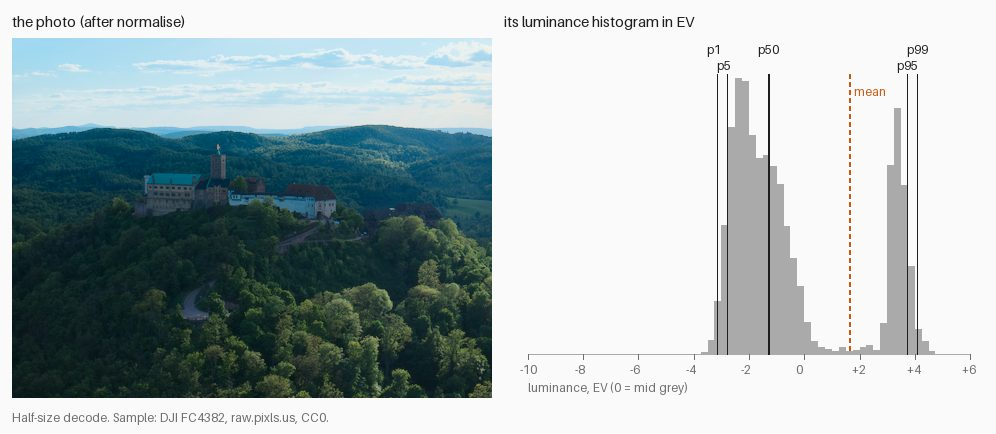
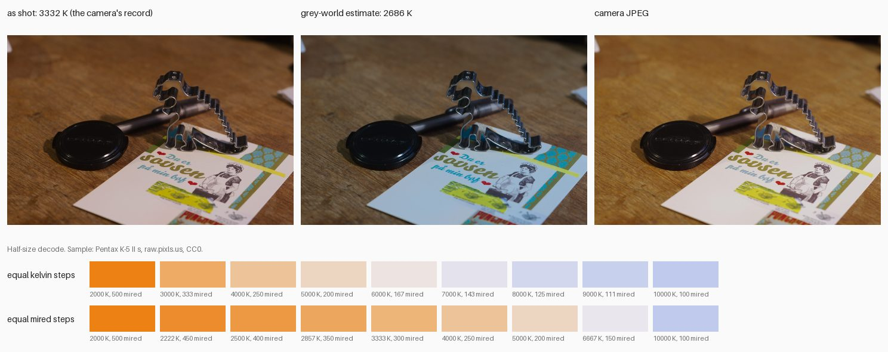
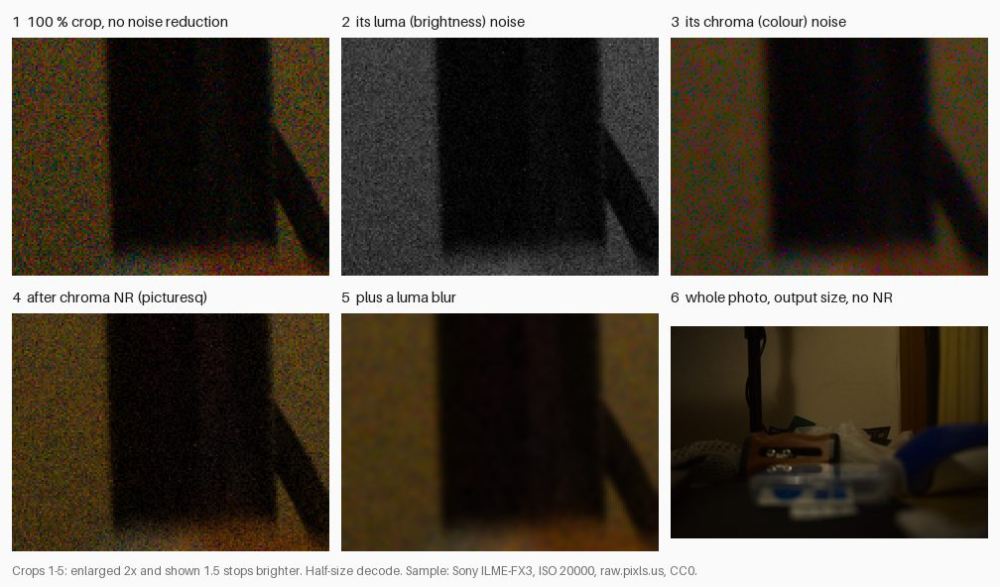

# M2 primer: measuring a photo before touching it

M2 builds the **normalise** stage: measure each photo (**stats**), check its white balance, flag anything odd (never silently "fix" it), and let the user set per-photo **overrides** (`exposure_ev`, `wb_kelvin`, `tint`). Three ideas carry it: brightness in stops, white balance, and noise. Each section has one example from a CC0 sample, a figure, and where it lives in the code. About a 5-minute read; the [learning log](../learning-log.md) links go deeper.

Figures: `scripts/primer_figures.py --only m2` (half-size decodes of CC0 samples from [raw.pixls.us](https://raw.pixls.us)).

---

## 1. Brightness in stops, and the histogram

A **stop** (1 EV) is a doubling of light, so we measure brightness as `EV = log2(luminance / 0.18)`: 0 is mid grey, +1 is twice as bright, −1 half. A **histogram** counts how many pixels fall at each brightness. Drawn in EV, every stop gets the same width, which matches how we see.

*Two humps: the forest (left, around −2 EV) and the sky (right, around +3.5 EV). Sample: DJI FC4382, CC0.*

Rather than store the whole histogram, the stats keep a few **percentiles**: p50 (the median) is the brightness half the pixels are below; p1 and p99 are the near-darkest and near-brightest, ignoring a handful of extreme pixels. For this photo:

| p1 | p5 | p50 | p95 | p99 | mean |
|---|---|---|---|---|---|
| −3.1 | −2.8 | **−1.3** | +3.7 | +4.1 | +1.6 |

**Why the median, not the mean.** The mean is computed on linear light, and one sky pixel at +4 EV carries as much light as 40 forest pixels at −1.3 EV. So the sky (a quarter of the frame) drags the mean up to +1.6 EV, brighter than 75 % of the pixels. "Make the mean mid grey" would darken the whole photo by 1.6 stops, sinking the forest (the subject) to almost −3 EV. The median doesn't care how bright the sky is, only that it's the brighter quarter, so it describes the subject.

**Where this lives:** `colour/transfer.py` (`linear_to_ev`), `normalise/exposure.py` (`median_ev`; the +2 EV camera-fitted offset), `normalise/stats.py` (#81: p1–p99, dynamic range, clipped fraction).
**Deeper:** [EV is log2 of light](../learning-log.md#2026-10-12--ev-is-log2-of-light), [Histograms and percentiles in EV](../learning-log.md#2026-10-18--histograms-and-percentiles-in-ev-why-the-median-and-not-the-mean).

---

## 2. White balance: kelvin, tint and mired

Light has a colour. Tungsten bulbs are orange, shade is blue, and our eyes adapt so a white card looks white under both. A camera doesn't adapt, so the RAW needs **white balance**: per-channel gains that make neutral things neutral. People describe it with two numbers:

- **Temperature** (kelvin): warm ↔ cool, along the colours a heated object glows. Tungsten ~2850 K, daylight ~5500–6500 K.
- **Tint**: green ↔ magenta, for lights that aren't on that line (fluorescent tubes, many LEDs).

**Compare in mired, not kelvin.** Kelvin is a misleading ruler: our eyes respond roughly to its reciprocal. **Mired** is `1 000 000 / kelvin`. Going 500 K warmer at 3000 K is 67 mired, a big visible shift; 500 K warmer at 6500 K is 13 mired, barely visible. The scale in the figure shows it: equal kelvin steps crowd all the change into the warm end, equal mired steps look evenly spaced. That's why the WB check's threshold, `flag_disagreement_mired`, is in mired.

*Sample: Pentax K-5 II s, tungsten light at night, CC0.*

**As-shot vs estimated.** The camera records the white balance it chose (**as-shot**): 3332 K here (300 mired). normalise also **estimates** the light from the pixels. The simplest estimate is **grey-world**: assume the scene averages to grey, so the photo's average colour must be the light's colour.

**Grey-world fails on a scene full of one colour.** This photo is mostly orange wooden table. Grey-world reads "orange on average" as "very warm light", estimates 2686 K (372 mired, 72 away from as-shot), and neutralises the table: the wood goes grey and the white card turns blue (middle panel). Neither answer is simply right: our as-shot render (left) leaves the card cream, while the camera's own JPEG (right) makes the card white and keeps the wood warm. Its engine neutralises more than the white balance it records ([#57](https://github.com/eddiemg10/picturesq/issues/57)). That's why picturesq **flags** disagreement (`wb_disagreement`) instead of correcting it: the user looks and, if needed, sets `wb_kelvin`/`tint` for that photo.

**Where this lives:** `decode/dng_colour.py` (the as-shot white and its temperature), `colour/temperature.py` (`xy_to_cct`, `bradford_matrix`; kelvin/tint ↔ xy and the re-balancing matrix: #80), `normalise/white_balance.py` (estimate and check: #83), per-photo overrides (#82, #87).
**Deeper:** [Temperature, tint and mired](../learning-log.md#2026-10-18--temperature-tint-and-mired-two-numbers-for-a-white), [Grey-world: the average colour is not always grey](../learning-log.md#2026-10-18--grey-world-the-average-colour-is-not-always-grey), [A camera has two colour matrices](../learning-log.md#2026-10-17--a-camera-has-two-colour-matrices-and-the-light-decides-the-mix).

---

## 3. Noise: colour is cheap to clean, brightness isn't

Every photosite's count has random error, and it matters most where little light arrived: the shadows. It shows up two ways (panels 2 and 3 split one crop into them):

- **Luma noise**: random brightness speckle, like film grain.
- **Chroma noise**: blotchy red/green/magenta speckle. It looks digital and ugly.

*Sample: Sony ILME-FX3 at ISO 20000, CC0.*

**Chroma NR is cheap and safe.** Our eyes resolve colour far more coarsely than brightness (JPEG stores colour at half resolution for the same reason). So we can smooth colour heavily: each shadow pixel keeps its own brightness and takes its neighbourhood's average colour. Panel 4: the colour blotches are gone, but the edges are still sharp, because edges are mostly brightness. picturesq already does this in normalise (M1); it brought our darkest tones from 1.33× to ~1.06× the camera JPEG's chroma.

**Luma NR is harder.** Brightness noise and fine detail (hair, leaves, text) look the same to a filter: small, high-contrast variations. Smooth one and you smooth the other (panel 5: the speckle is gone, and so is the edge). Good luma NR has to guess which is which, which is why it's deferred: it comes forward only if night photos need it (project plan, §10 "Later" and §11 risks).

**Judge noise at output size.** Panel 6 is the same photo, with no noise reduction, at the size it will be shown: the noise has nearly vanished. Shrinking averages neighbouring pixels, and random noise partly cancels: averaging 4 pixels halves it, averaging 16 quarters it. A 4240 px wide photo shown 1080 px wide averages about 15 pixels into each, so its noise drops to about a quarter. Noise that looks alarming at 100 % may be invisible in the export.

**Where this lives:** `normalise/chroma_nr.py` (`chroma_noise_reduction`), config `normalise.chroma_nr` (`amount`, `radius`, `full_lightness`, `fade_lightness`); luma NR isn't implemented.
**Deeper:** [Colour noise lives in the chroma channels](../learning-log.md#2026-10-14--colour-noise-lives-in-the-chroma-channels), [Judge noise at the size people will see](../learning-log.md#2026-10-18--judge-noise-at-the-size-people-will-see).

---

## Gotchas

- **Exposure in gamma space.** Doubling an sRGB-encoded value isn't doubling the light: mid grey ×2 becomes 4.6× the light. Exposure is `× 2**ev` on scene-linear values only ([M1 primer, section 2](m1-neutral-render.md#2-scene-linear-vs-display-referred)).
- **White balance in display space.** Same mistake, per channel: a 1.5× red gain on encoded mid grey is a 2.4× gain in light, so the cast is over-corrected and the error differs with brightness. WB gains and re-balancing matrices run on scene-linear values, before the display transform.
- **Judging noise at 100 %.** Pixel-peeping a 24 MP photo exaggerates its noise compared with any real viewing size, and tempts you into luma NR that smears detail. Judge at the size of the export's outputs, and judge colour noise in the shadows, where it lives.

## Quick check

A beach photo is mostly bright sand, with a person in a dark top at the edge. Grey-world estimates the light as warmer than the camera recorded, by 40 mired. What happens if picturesq "fixes" it automatically, and what does it do instead?

Answer

Sand is warm-coloured, so grey-world mistakes "warm scene" for "warm light" (the scene-full-of-one-colour failure). Correcting by 40 mired would cool the whole photo: the sand turns grey-beige and skin goes cold. picturesq instead raises a `wb_disagreement` flag (if 40 mired is above `flag_disagreement_mired`); the user looks, and either keeps the as-shot white balance or sets `wb_kelvin`/`tint` as an override for that photo.

