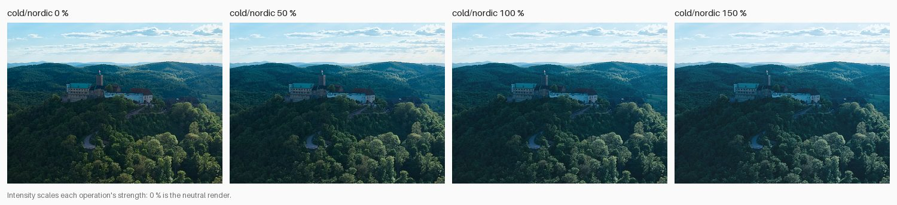
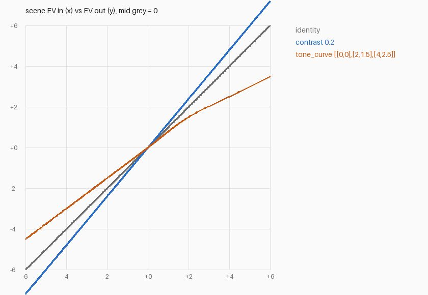
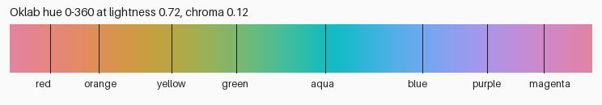

# M3 primer: looks, from recipe to pixels

M3 builds the **grade** stage. A **look** (e.g. `cold/nordic`) is a short recipe of **operations** in a YAML **look file**: "a little cooler, more contrast, blue shadows, less colour, lifted blacks". This primer covers four ideas: tone curves, OkLCh, LUTs and split toning, plus the rule that makes **intensity** work. Each section has one example, worked out with picturesq's own functions, and says where it lives in the code. About a 5-minute read; the [learning log](../learning-log.md) links go deeper.

Figures: `scripts/primer_figures.py --only m3` (the DJI CC0 sample from [raw.pixls.us](https://raw.pixls.us)).



*Intensity 0 % is exactly the neutral render; 150 % is half as much again. Sample: DJI FC4382, CC0.*

---

## 0. Intensity scales the recipe, not the result

You might expect "50 % of a look" to blend the finished look 50/50 with the original, like a layer's opacity. That gets most operations wrong: blend a +1 EV image with the original and you get 1.5× the light, **+0.58 EV**, not +0.5. So each operation declares, for every value that sets *how much* it does, the **neutral value** at which it does nothing (0 EV, 0 mired, contrast 0). Intensity moves the value from neutral toward the look's: `neutral + intensity × (value − neutral)`. At 0 every operation is skipped, so the export is byte-identical to the neutral render (tested on real samples). Values that say *where* or *which* (a pivot, a hue) aren't scaled.

**Where this lives:** `config/operations.py` (`scaled(neutral)`), `grade/operations.py` (`apply_operation`), [ADR-0019](../decisions/0019-grade-operations-and-intensity.md).
**Deeper:** [Intensity: scale the recipe, not the result](../learning-log.md#2026-10-18--intensity-scale-the-recipe-not-the-result).

---

## 1. Tone curves and contrast, in stops

A **tone curve** says where each brightness ends up. picturesq draws it in **stops relative to mid grey** on both axes, so a straight 45° line changes nothing, and steeper means more contrast.



- **`contrast`** is a straight line through a **pivot** (mid grey, 0.18, by default) with slope `1 + amount`. With `amount: 0.2`, a tone 2 stops above mid grey goes to **2.4 stops**, and one 2 stops below goes to −2.4. It's the same in the shadows and the highlights, because a stop is a stop at any brightness. Doing contrast on linear values instead would mostly stretch the highlights.
- **`tone_curve`** goes through points you give it, e.g. `[[0, 0], [2, 1.5], [4, 2.5]]`: mid grey stays, and 2 stops up becomes 1.5 (**softer highlights**). The curve is smooth and never overshoots between points (monotone cubic). Past the last point it continues straight at the end slope, so softened highlights stay soft.
- Both multiply R, G and B by the same factor, so colours keep their hue and saturation. A curve applied to each channel separately would also shift colours.

**Gotcha:** these run on **scene** light, before the display transform, which still rolls highlights off toward white. A tone curve doesn't replace the display transform; it moves tones before the transform places them.

**Where this lives:** `grade/operations.py` (`contrast`, `tone_curve`, `tone_curve_table`).

---

## 2. OkLCh: lightness, chroma and hue as separate dials

To change colour without changing brightness you need a space where those are separate numbers. **Oklab** is one: L is perceived lightness, and a/b are the colour, so `chroma = √(a² + b²)` is how colourful a pixel is and `hue = atan2(b, a)` is which colour it is. In polar form that's **OkLCh**. `saturation`, `vibrance`, `hsl` and `split_tone` all change only chroma and hue, so lightness stays put (tests check it to 1e-4).

Compare editors' HSL. Desaturating pure sRGB blue in HSL gives a grey that is **1.2 stops brighter** than a grey of the same perceived lightness, because HSL's "lightness" is just `(max + min) / 2` of the encoded numbers.



**Hue bands:** the `hsl` operation changes eight overlapping bands. Their centres were measured in Oklab from real colours, not copied from HSL's 0/60/120°. Skin (about 49°) falls in `orange` and sky (about 255°) in `blue`, so "darker sky" is `hsl: {blue: {lightness: -0.5}}`. Neighbouring bands blend smoothly, and greys aren't touched, since a grey's hue is just noise.

**Where this lives:** `colour/oklab.py`, `grade/operations.py` (`saturation`, `vibrance`, `hsl`), `config/operations.py` (`HUE_BANDS`).
**Deeper:** [Why colour operations work in OkLCh, not HSL](../learning-log.md#2026-10-18--why-colour-operations-work-in-oklch-not-hsl).

---

## 3. LUTs: a colour lookup table, in the right space

A `.cube` **3D LUT** is a cube of input colours (17³, 33³ or 65³) with, for each, the colour it should become. It can hold any colour change, which is why film emulations ship as LUTs. Two things make a LUT go wrong:

1. **The input space.** The table's corners mean "this sRGB value". Feed it linear or log values and every pixel lands in the wrong cell. So every `lut` operation declares `input_space` (`srgb` or `rec709`). picturesq encodes the display transform's output into that space, looks the colour up, and decodes back. LUTs run after the display transform, on display values.
2. **In-between colours.** Almost every pixel falls between grid points. **Tetrahedral** interpolation blends four corners of the cell, along the grey diagonal, rather than all eight (trilinear). In a test cell with a neutral grey diagonal and one coloured corner, mid grey through trilinear came out `(0.5, 0.5, 0.54)`, a blue cast. Through tetrahedral it came out exactly `(0.5, 0.5, 0.5)`.

**Where this lives:** `colour/lut.py` (our own numpy code; colour-science is only the test oracle, matched to 9e-8), the `lut` operation in `grade/operations.py`.
**Deeper:** [What a 3D LUT is, and why tetrahedral interpolation](../learning-log.md#2026-10-18--what-a-3d-lut-is-and-why-tetrahedral-interpolation).

---

## 4. Split toning: one hue for the shadows, another for the highlights

**Split toning** tints dark tones toward one hue and bright tones toward another: cool shadows under warm highlights is the classic. `cold/nordic` uses `split_tone: {shadows: {hue: 235, amount: $shadow_tint}, …}`. The tint is added to Oklab a/b, so lightness is unchanged. It's added in proportion to lightness, so black stays black. And it blends smoothly from shadows to highlights around mid grey (Oklab L 0.565), where `balance` moves the crossover. `amount: 1` adds 0.1 of chroma at mid grey, which is strong; looks use 0.1–0.4.

**Gotcha:** a tint stacks on the scene's own colour. Teal shadows on a tungsten-lit room (already orange-yellow) come out olive. The look's sliders and its intensity are there for exactly that.

**Where this lives:** `grade/operations.py` (`split_tone`).

---

## Try it

```bash
picturesq looks                                   # what's in the library, with sliders
picturesq preview ./lisbon --category cold        # every photo x every cold look, from proxies
```

Then set `grade.look: {name: cold/nordic, intensity: 0.8}` in `picturesq.yaml` and run `picturesq preview ./lisbon --look cold/nordic`. The blue-bordered column is what `picturesq export` will give.

## Quick check

*A look applies `exposure: {ev: 1}` and `contrast: {amount: 0.2}`. At 50 % intensity, how many stops above mid grey does a tone that started at mid grey end up?*

<details><summary>Answer</summary>

Intensity scales each value: +0.5 EV, then contrast 0.1. Mid grey goes up to +0.5 EV, and contrast pivots on mid grey, so +0.5 becomes 0.5 × 1.1 = **+0.55 stops**. (Blending the full look 50/50 with the original would give something else.)

</details>
